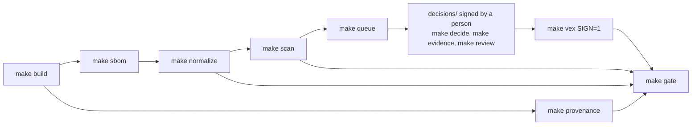

# From Firmware Build to CRA Evidence

Demo repository for the talk *"From Firmware Build to CRA Evidence: A Reproducible SBOM
and Vulnerability Workflow"* (edge lab LIVE! at electronica 2026). Open tools only,
Apache-2.0.

A Zephyr sensor node (MQTT over TLS, Raspberry Pi RP2350 + W5500 Ethernet, or native_sim)
goes from source to release evidence: reproducible build, SBOM, signed provenance,
vulnerability findings from two scanners, decisions made by a person with evidence from
the build, signed OpenVEX, and a release gate. Five scenarios show where this breaks in
practice and what the evidence looks like when it does.

**Not a product.** It is a reference for engineers who need to set up something similar
(see `docs/ci-checklist.md` for what to change). Nothing here is legal advice.

## What you can look at without building anything

- `samples/`: real outputs of the v1.0 and v1.1 releases (SBOMs, findings, VEX, gate result)
- `decisions/v1.0/w5500_evb_pico2_rp2350a_m33/`: one decision per finding, with evidence
- `scenarios/README.md`: the five failure modes, what each shows, expected output

## Quickstart

Requirements: Linux or Windows with WSL2 (run everything in the WSL2 shell), Docker,
GNU make, bash, git; x86_64; about 15 GB free disk.

```bash
git clone <this repo> && cd <repo>
make env                                   # tooling image (network, once)
make fetch VULNDB_MIRROR=<dir>             # west workspace + DB snapshots (network, once)
make doctor                                # every pin and checksum: PASS (offline)
make keys                                  # your own signing key pair
make pipeline VERSION=v1.0 BOARD=w5500_evb_pico2/rp2350a/m33
```

`make pipeline` builds, makes the SBOM, signs provenance, normalizes, scans, builds the
signed VEX and runs the gate, offline. The certificates compiled into the firmware are
committed, so your build has the same firmware hash as the committed decisions and the
gate result is real: with the `baseline` snapshot it passes; with a newer snapshot it
fails on every finding that has no decision yet (that is scenario 5).

The recorded vulnerability DB snapshots are not in git (about 200 MB each). `make fetch`
downloads them and checks the recorded sha256. The OSV database is only served as
"latest", so a fresh clone needs the archives from someone who recorded them
(`VULNDB_MIRROR=<dir>`), or records its own snapshot (`make snapshot NAME=<name>`).

## The flow



Details: `docs/architecture.md`. File formats: `docs/data-model.md`.

| Step | Command | Docs |
| --- | --- | --- |
| Environment, pins, DB snapshots | `make env fetch doctor snapshot` | `docs/environment.md` |
| Build (native_sim or board), run | `make build run` | `docs/hardware.md` |
| SBOM (`west spdx`, SPDX 2.3) | `make sbom` | `docs/sbom.md` |
| Signed provenance, reproducibility | `make provenance verify reproduce-check` | `docs/provenance.md`, `docs/reproducibility.md` |
| Validation, normalization, identifier map | `make validate normalize` | `docs/sbom-quality.md` |
| Grype + OSV-Scanner, review queue | `make scan queue` | `docs/scanning.md` |
| Build evidence for a file / function | `make evidence FILE=... [SYMBOL=..] [KCONFIG=..]` | `scenarios/3-config-dependent/` |
| Decisions, review, OpenVEX | `make decide review vex` | `docs/decisions.md`, `docs/vex-formats.md` |
| Release gate | `make gate` | `docs/gate.md` |
| Release diff | `make diff A=v1.0 B=v1.1` | `scenarios/4-config-change/` |
| Scenarios, presenter tooling | `make demo prepare ready reset scenario-N record-N play-N` | `scenarios/README.md`, `docs/presenting.md` |

`make help` lists every target. All steps after `make fetch` run with `--network none`.

## Releases

- **v1.0** (`app/`): IPv4 only, cJSON 1.7.17 vendored with one backported upstream fix.
- **v1.1** (`releases/v1.1/`): v1.0 + `CONFIG_NET_IPV6=y`. Exists for scenario 4.

## Limitations (known, on purpose or not yet solved)

- One board is fully decided (`w5500_evb_pico2/rp2350a/m33`); native_sim builds and scans
  but has no decisions.
- Components pinned only by commit (cmsis_6, hal_rpi_pico) cannot be matched offline.
- Grype matches the SBOM by CPE; NVD's CPE ranges are coarse (Zephyr `< 4.5.0` for fixes
  already backported to v4.4.x). OSV disagrees for 24 of 26 Zephyr findings
  (`docs/scanning.md`). The tools are not wrong; they answer different questions.
- `make evidence` proves presence or absence of code in one binary. It does not prove
  reachability of code that is present.
- The reviewer check in the gate is a name pattern; real identity comes from code review
  and signed commits (`docs/ci-checklist.md`).
- The analysis in `decisions/` and in `identifiers/component-map.yaml` was drafted by an AI
  assistant with the evidence attached. A decision counts only after a person has reviewed
  and signed it (`make review`); the header of each file says which state it is in.
- One synthetic record exists, clearly labelled: `docs/synthetic-data.md`.

## Where things are pinned

- `pins.env`: Zephyr commit, module SHAs, base image digest, SDK, CLI tools (+ sha256)
- `requirements.lock`: Python packages with hashes
- `vulndb/snapshots.yaml`: vulnerability DB snapshots (URL, sha256, build date)
- `versions.lock.md`: generated, human-readable view of all of the above

## License

Apache-2.0 (`LICENSE`). Vendored cJSON: MIT (`app/lib/cjson/LICENSE`).
