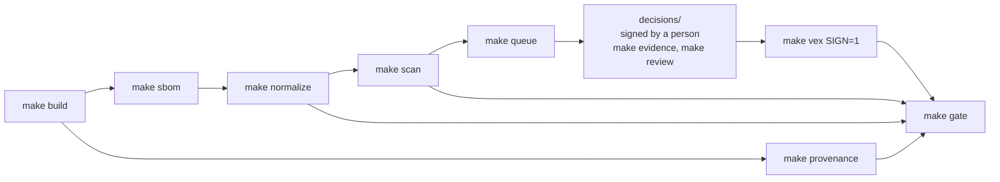

# cra-evidence-demo

**From firmware build to CRA evidence: a reproducible SBOM and vulnerability workflow for
Zephyr firmware, built from open tools, with five real failure modes worked through
end to end.**

This is the demo repository for the talk *"From Firmware Build to CRA Evidence: A
Reproducible SBOM and Vulnerability Workflow"* (edge lab LIVE! at electronica 2026). It
takes a small connected Zephyr device from source code to the evidence a manufacturer
needs to answer one question: *is this exact firmware affected by this vulnerability,
who decided, and based on what?*

- **Reproducible build** of the firmware, with signed SLSA provenance
- **SPDX 2.3 SBOM** from `west spdx`, validated and normalized
- **Two vulnerability scanners** (Grype and OSV-Scanner), run offline against frozen,
  checksummed database snapshots
- **A review queue and decision files**: every finding gets a decision by a person, with
  evidence taken from the build itself
- **Signed OpenVEX** generated from those decisions
- **A release gate** that passes or fails a firmware build, rule by rule

Everything is bound to the SHA-256 of the firmware file. Scanner output is never
accepted as a decision.

> This is a reference and teaching repository, not a product. It runs one Zephyr
> application on one board. Nothing here is legal advice. See [Limitations](#limitations).

## Contents

- [The five failure modes](#the-five-failure-modes)
- [What is in the repository](#what-is-in-the-repository)
- [Look first, run later](#look-first-run-later)
- [Requirements](#requirements)
- [Setup](#setup)
- [Run the pipeline](#run-the-pipeline)
- [Run the five scenarios](#run-the-five-scenarios)
- [Run the firmware](#run-the-firmware)
- [Command reference](#command-reference)
- [How decisions work](#how-decisions-work)
- [Limitations](#limitations)
- [Security notes](#security-notes)
- [License and credits](#license-and-credits)

## The pipeline



Each step is one `make` target. It runs in a pinned Docker image with `--network none`
and writes plain JSON, YAML or SPDX files to `out/<release>/<board>/`. There is no
database and no service. Details: [`docs/architecture.md`](docs/architecture.md).

## The five failure modes

These are where automated SBOM and vulnerability tooling falls short in practice. Each
one is a script that runs live in the talk (`make scenario-N`), on real data.

| # | Failure mode | What the demo shows |
| --- | --- | --- |
| 1 | **Ambiguous identifiers** | cJSON copied into the application tree is invisible to both scanners. One reviewed identifier-map entry reveals 8 findings, including a Critical one, and build evidence shows that its code is not compiled in. |
| 2 | **Supplier patch not in public databases** | A backported upstream fix leaves the version at 1.7.17, so every database still reports CVE-2024-31755. A test against the original and the patched code is the evidence; the status is `fixed`, and the signed VEX says so. |
| 3 | **CVE in the library, not in the configuration** | A Zephyr ICMPv6 CVE in firmware built without IPv6. Four independent checks from the build (SBOM, `.config`, linker map, symbols) show the code is absent. |
| 4 | **Components change between versions** | Release v1.1 enables IPv6. The scanner output is identical to v1.0, but four v1.0 decisions no longer hold. The gate blocks v1.1 until every decision is reviewed again. |
| 5 | **New advisory after release** | The archived SBOM of released firmware is scanned again with newer data. The gate fails for firmware already in the field; a person opens an investigation with a due date and the VEX is updated. |

Each scenario has a README with the expected output: [`scenarios/`](scenarios/README.md).

## What is in the repository

| Path | Content |
| --- | --- |
| `app/` | The Zephyr application: a sensor node that publishes JSON over MQTT with TLS. Includes the vendored cJSON (`app/lib/cjson/`) with its upstream patch. |
| `releases/v1.1/` | Release v1.1 = v1.0 plus `CONFIG_NET_IPV6=y` (scenario 4) |
| `pipeline/` | The workflow code: Python 3.12, typed, about 20 small modules, one per step |
| `decisions/` | One reviewed decision per finding for release v1.0 on the W5500-EVB-Pico2 |
| `identifiers/` | The reviewed identifier map that adds CPEs and PURLs `west spdx` cannot know, with its schema |
| `policy/gate.yaml` | The release gate rules (severity threshold, eight rules) |
| `schema/` | JSON Schema for decisions; the vendored, pinned OpenVEX schema |
| `scenarios/` | The five failure-mode scenarios, presenter menu, helpers |
| `samples/` | Real outputs of the pipeline (SBOMs, findings, VEX, gate result), for reading without building |
| `docs/` | One document per topic, listed below |
| `docker/`, `pins.env`, `requirements.lock`, `west.yml` | The pinned environment: base image digest, Zephyr and module commits, SDK and tool checksums, Python packages with hashes |
| `vulndb/snapshots.yaml` | The recorded vulnerability database snapshots (URL, sha256, date). The archives themselves are not in git. |
| `certs/` | Demo-only CA and broker certificate (see [Security notes](#security-notes)) |
| `keys/cosign.pub` | Public key that verifies the committed samples |
| `.github/workflows/pipeline.yml` | The same pipeline in CI, as a starting point |

Documentation:

| Topic | Document |
| --- | --- |
| Environment, pins, offline operation | [`docs/environment.md`](docs/environment.md) |
| Hardware, wiring, flashing | [`docs/hardware.md`](docs/hardware.md) |
| What `west spdx` produces, and its gaps | [`docs/sbom.md`](docs/sbom.md) |
| SBOM validation and normalization | [`docs/sbom-quality.md`](docs/sbom-quality.md) |
| Provenance and signing | [`docs/provenance.md`](docs/provenance.md) |
| Reproducible builds | [`docs/reproducibility.md`](docs/reproducibility.md) |
| Scanners and why they disagree | [`docs/scanning.md`](docs/scanning.md) |
| Decisions | [`docs/decisions.md`](docs/decisions.md) |
| OpenVEX, CSAF and Grype | [`docs/vex-formats.md`](docs/vex-formats.md) |
| Release gate | [`docs/gate.md`](docs/gate.md) |
| File formats and data model | [`docs/data-model.md`](docs/data-model.md) |
| Running the demo on stage | [`docs/presenting.md`](docs/presenting.md) |
| The one synthetic record | [`docs/synthetic-data.md`](docs/synthetic-data.md) |
| Taking this into a real product | [`docs/ci-checklist.md`](docs/ci-checklist.md) |

## Look first, run later

You can see most of the results without installing anything:

- [`samples/`](samples/README.md): the real SPDX SBOMs, findings, OpenVEX document and
  gate result of release v1.0, and the v1.1 comparison
- [`decisions/v1.0/w5500_evb_pico2_rp2350a_m33/`](decisions/): 37 decision files, each
  with its evidence and the condition under which it must be reassessed
- [`scenarios/`](scenarios/README.md): each failure mode, step by step, with the expected output
- [`policy/gate.yaml`](policy/gate.yaml) and [`docs/gate.md`](docs/gate.md): what a release must pass

## Requirements

- Linux, or Windows 10/11 with WSL2 (run every command in the WSL2 shell)
- Docker (on Windows: Docker Desktop with WSL2 integration)
- GNU make, bash, git
- x86_64 (only linux/amd64 tools are pinned)
- Roughly 15 GB of free disk space (image, Zephyr workspace, database snapshots)
- Network access for the setup steps only

No hardware is needed for the pipeline or the scenarios. Every evidence step works on
the built firmware file.

## Setup

Run these once, after cloning. Only these steps use the network.

```bash
git clone https://github.com/waleedaman/cra-evidence-demo.git
cd cra-evidence-demo
make env                         # build the pinned tooling image
make snapshot NAME=mine          # record today's vulnerability databases (about 400 MB)
make fetch SNAPSHOTS=mine        # Zephyr workspace + import your snapshot
make doctor SNAPSHOTS=mine       # offline: every version, pin and checksum must PASS
```

**Why your own snapshot?** The talk uses a snapshot named `baseline`, recorded on
2026-10-15. Its checksums are in `vulndb/snapshots.yaml`, but the archives are too large
for git, and the OSV database is only served as "latest", so it cannot be downloaded
again with the same checksum. If someone gives you the recorded archives, use them
instead: `make fetch VULNDB_MIRROR=<dir>` and `make doctor`.

Then create your own signing key and commit the changes locally. The gate checks that
the firmware was built from a clean, committed tree.

```bash
mv keys/cosign.pub keys/presenter.pub    # keep the key that verifies samples/
make keys                                # your key pair; keys/cosign.key stays git-ignored
git add -A && git commit -m "local: own DB snapshot and signing key"
```

## Run the pipeline

```bash
make pipeline VERSION=v1.0 BOARD=w5500_evb_pico2/rp2350a/m33 SNAPSHOT=mine
```

This builds the firmware, makes the SBOM, signs the provenance, normalizes, scans, builds
the signed VEX and runs the gate, all offline, in a few minutes.

What to expect:

- **The same firmware.** The certificates compiled into the firmware are committed, so your
  `zephyr.uf2` should have the same SHA-256 as in the committed decisions
  (`0ef23d019b60828e...`). If it does not, please open an issue; that is a
  reproducibility bug.
- **More findings than in the talk.** Your snapshot is newer than `baseline` (37 findings),
  so expect new findings. They have no decision yet, so the gate **fails** on rule R4 and
  lists them. That is not an error: it is failure mode 5, on real data.
- To work through a new finding:

  ```bash
  make queue    VERSION=v1.0 BOARD=w5500_evb_pico2/rp2350a/m33   # what is open
  make evidence VERSION=v1.0 BOARD=... FILE=subsys/net/ip/<file>.c  # is the code in the firmware?
  make decide   VERSION=v1.0 BOARD=... VULN=<id>                 # draft a decision file
  #   ...complete the YAML file...
  make review   VERSION=v1.0 BOARD=... REVIEWER="Your Name"      # sign it
  make vex VERSION=v1.0 BOARD=... SIGN=1 && make gate VERSION=v1.0 BOARD=...
  ```

With the original `baseline` archives, the gate passes for v1.0. The `baseline` snapshot
exceeds the policy's 60-day snapshot age limit after mid-December 2026; to evaluate the
gate as of the talk, set `GATE_DATE=2026-11-12`.

## Run the five scenarios

```bash
export REVIEWER="Your Name"    # scenario 5 opens an investigation in this name
export SNAPSHOT=mine           # omit if you have the baseline archives
make prepare                   # build + scan v1.0 and v1.1, VEX + gate for v1.0
make ready                     # readiness check, every row OK
make demo                      # menu; or run make scenario-1 ... make scenario-5
make reset                     # remove the scenario workspaces
```

Each step prints the command it runs, waits for Enter, then runs it. Each scenario
works on its own copy under `out/scenarios/<N>/`, so it can be run any number of times
and never changes tracked files. The whole screen output is also saved to
`out/scenarios/<N>/transcript.log`.

The scenarios reproduce the talk's numbers exactly only with the `baseline` snapshot.
Scenario 5 starts from a passing v1.0 gate, so with your own snapshot, first decide the
extra findings (see above).

Scenario 5 needs one newer data point than the scan before it. When no newer snapshot
named `after` exists, it uses one **synthetic** OSV record, `DEMO-2026-0001`. The record
is clearly labelled on screen and documented in
[`docs/synthetic-data.md`](docs/synthetic-data.md). Everything else in this repository is
real data.

## Run the firmware

On your PC, without hardware (Zephyr `native_sim`, talking to a local Mosquitto broker
over TLS on an internal Docker network):

```bash
make build VERSION=v1.0
make run
```

On the board (WIZnet W5500-EVB-Pico2, or a Raspberry Pi Pico 2 with a W5500 module):

```bash
make build VERSION=v1.0 BOARD=w5500_evb_pico2/rp2350a/m33
# flash out/v1.0/w5500_evb_pico2_rp2350a_m33/zephyr.uf2: hold BOOTSEL, plug in USB, copy
```

Wiring, network setup and console: [`docs/hardware.md`](docs/hardware.md).

## Command reference

`make help` lists every target.

| Step | Commands |
| --- | --- |
| Environment | `make env`, `make snapshot NAME=..`, `make fetch`, `make doctor`, `make lint` |
| Build and run | `make build VERSION=.. [BOARD=..]`, `make run`, `make reproduce-check` |
| SBOM | `make sbom`, `make validate`, `make normalize` |
| Provenance | `make keys`, `make provenance`, `make verify` |
| Vulnerabilities | `make scan [SNAPSHOT=..]`, `make queue`, `make finding VULN=..` |
| Build evidence | `make evidence FILE=.. [SYMBOL=..] [KCONFIG=..]`, `make cjson-test` |
| Decisions and VEX | `make decide VULN=..\|open [FROM=<release>]`, `make review REVIEWER=..`, `make vex SIGN=1`, `make decision VULN=..`, `make vex-statement VULN=..` |
| Gate and releases | `make gate [GATE_DATE=..]`, `make pipeline`, `make diff A=v1.0 B=v1.1` |
| Scenarios | `make prepare`, `make ready`, `make demo`, `make scenario-N`, `make reset`, `make record-N`, `make play-N` |
| Samples | `make samples` |

Most targets take `VERSION=v1.0` or `VERSION=v1.1` and `BOARD=...` (default:
`native_sim/native/64`).

## How decisions work

A decision is a YAML file per finding, per release, per board, validated against
[`schema/decision.schema.json`](schema/decision.schema.json). It records:

- **What it is about:** the vulnerability, the component (by PURL or CPE), and the product
  (version and firmware SHA-256)
- **The status:** `not_affected` (with an OpenVEX justification), `affected`, `fixed` or
  `under_investigation` (with a due date)
- **The basis:** the evidence (build SBOM, `.config`, linker map, symbols, commits, tests),
  who decided and when, and the condition under which it must be reassessed

A decision only covers the exact firmware it names. Rebuild with any change and it no
longer applies. That is what scenario 4 shows.

The v1.0 decisions in this repository were **drafted by an AI assistant** from the build
evidence, then reviewed and signed one by one by a person with `make review`. The file
header of each decision records this. The gate rejects reviewer names that look like a
tool or an AI. Details: [`docs/decisions.md`](docs/decisions.md).

## Limitations

- **One application, one board.** Decisions exist only for `w5500_evb_pico2/rp2350a/m33`.
  `native_sim` builds and scans, but has no decisions.
- **Commit-pinned components** (cmsis_6, hal_rpi_pico) cannot be matched offline.
- **NVD ranges are coarse.** Grype matches by CPE, and NVD often says "Zephyr < 4.5.0" for
  fixes already in v4.4.x. OSV disagrees for 24 of 26 Zephyr findings
  ([`docs/scanning.md`](docs/scanning.md)).
- **Presence, not reachability.** `make evidence` proves whether code is in the binary,
  not whether code that is present can be reached.
- **Reviewer identity is a name pattern.** In a real product it comes from code review and
  signed commits ([`docs/ci-checklist.md`](docs/ci-checklist.md)).
- **Laptop keys.** Signing uses a local cosign key without a transparency log. That fits
  an offline demo, not a production release process.

## Security notes

- `certs/` holds a **demo-only** CA and broker key pair, committed on purpose so every
  clone builds identical firmware. They protect nothing; never reuse them.
- `keys/cosign.key` is git-ignored; only the public key is committed.
- The firmware is a demo. Do not deploy it.

## License and credits

Apache-2.0, see [`LICENSE`](LICENSE). The vendored cJSON is MIT
([`app/lib/cjson/LICENSE`](app/lib/cjson/LICENSE)).

Built on open tools: the [Zephyr Project](https://zephyrproject.org/) and `west spdx`,
[SPDX](https://spdx.dev/), [Grype](https://github.com/anchore/grype),
[OSV-Scanner](https://github.com/google/osv-scanner) and the [OSV](https://osv.dev/)
database, [OpenVEX](https://github.com/openvex) and vexctl,
[Sigstore cosign](https://github.com/sigstore/cosign), [SLSA](https://slsa.dev/) and
[in-toto](https://in-toto.io/), and the NTIA conformance checker.
