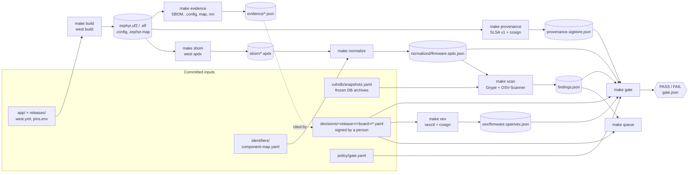

# Architecture

One firmware build flows through seven steps. Every step is one `make` target, runs in
the pinned tooling container with `--network none`, and writes plain files under
`out/<release>/<board>/`. Later steps only read earlier files; nothing is kept in a
database or a service.

## Principles

- **Bound to bytes.** The product is identified by PURL plus the SHA-256 of the firmware
  file. Findings, decisions, VEX statements and the gate all name that hash; a rebuild
  with any change makes them stale (scenario 4).
- **Facts from tools, judgement from people.** Tools produce SBOMs, findings and build
  evidence. Only a decision file signed by a person turns a finding into a status, and
  only decisions become VEX.
- **Offline and frozen.** After `make fetch`, everything runs without network against
  recorded DB snapshots (sha256 in `vulndb/snapshots.yaml`). Re-running a step gives the
  same result; a newer snapshot is an explicit, named input (scenario 5).
- **No hidden state.** Each step's output is a file you can open; the presenter tables are
  summaries of those files.

## Code map

| Step | Code | Output |
| --- | --- | --- |
| build | `scripts/build-firmware.sh`, `pipeline/artifacts.py` | firmware, `artifacts.json` |
| sbom | `west spdx`, `pipeline/sbom_report.py` | `sbom/*.spdx` |
| provenance, verify | `pipeline/provenance.py`, cosign | `provenance.*`, `verify.json` |
| reproduce-check | `pipeline/repro.py` | `repro/report.json` |
| validate, normalize | `pipeline/validate.py`, `pipeline/normalize.py`, `pipeline/spdxio.py` | `validate/`, `normalized/` |
| scan, queue | `pipeline/scan.py`, `pipeline/queue.py` | `findings.json`, `queue.json` |
| evidence | `pipeline/evidence_compiled.py` | `evidence/*.json` |
| decide, review | `pipeline/decide.py`, `pipeline/review.py`, `pipeline/decisions.py` | `decisions/` |
| vex | `pipeline/vex.py`, vexctl, cosign | `vex/` |
| gate | `pipeline/gate.py` | `gate.json` |
| diff | `pipeline/diff.py` | `diff-<a>.json` |
| scenarios | `scenarios/`, `pipeline/scenario.py` | `out/scenarios/<N>/` |
| environment | `docker/`, `pipeline/doctor.py`, `pipeline/vulndb.py`, `pipeline/lockdoc.py` | `versions.lock.md` |
